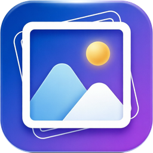
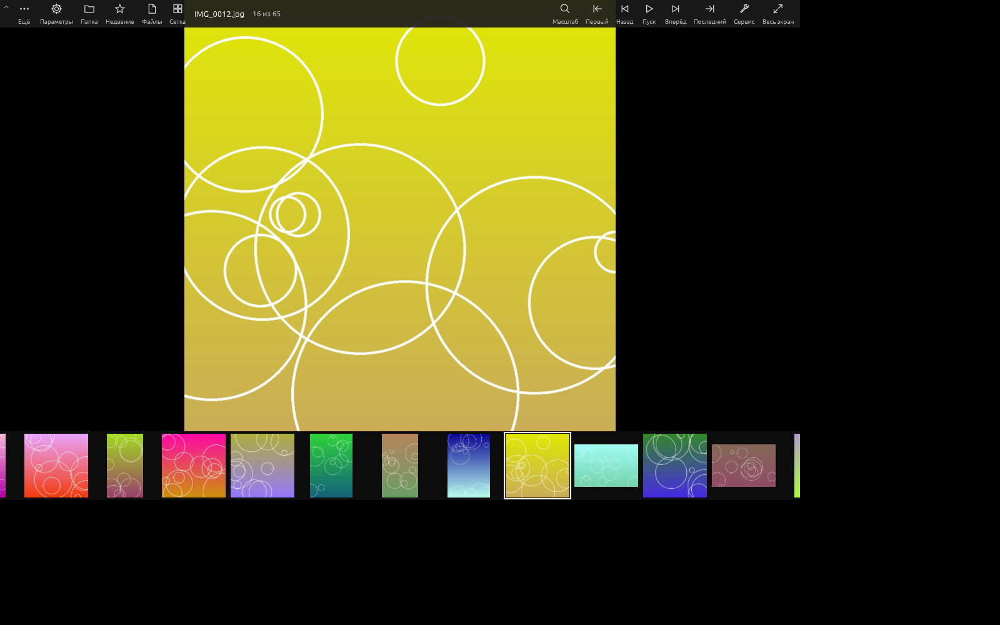
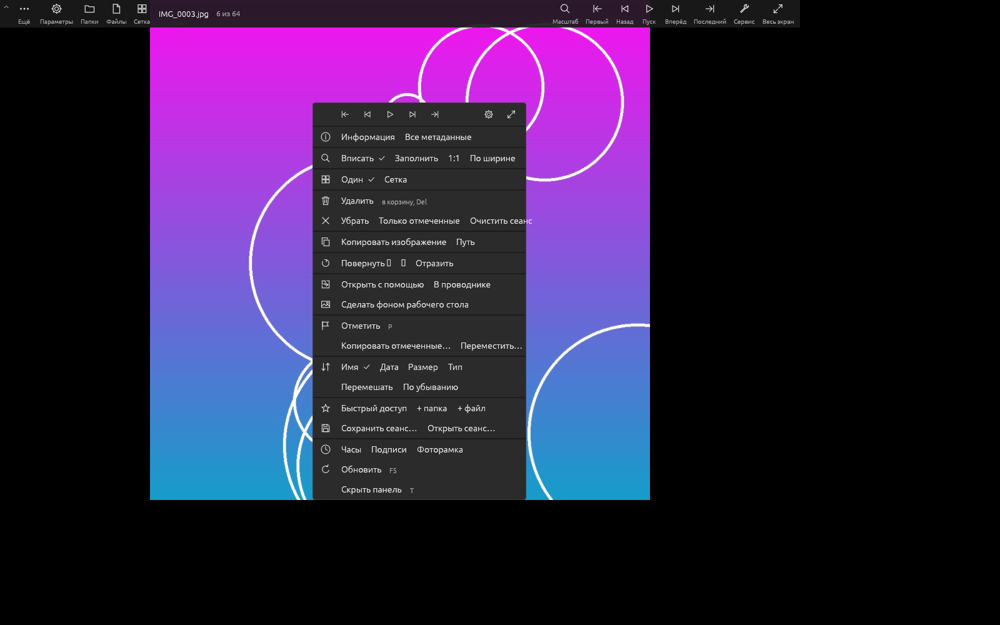
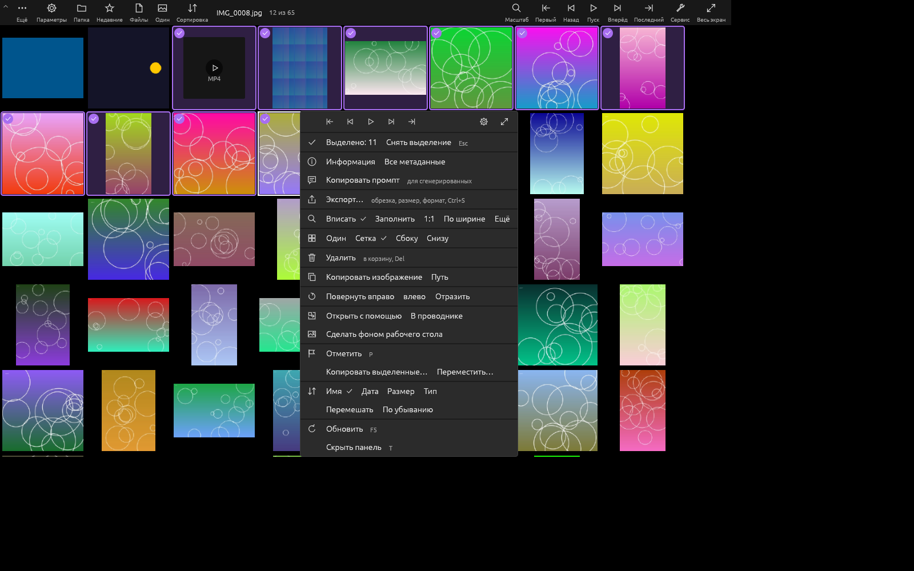
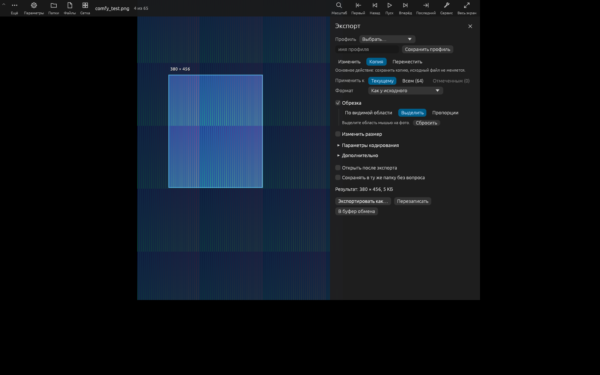
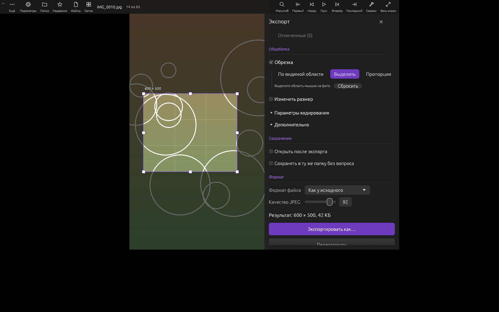
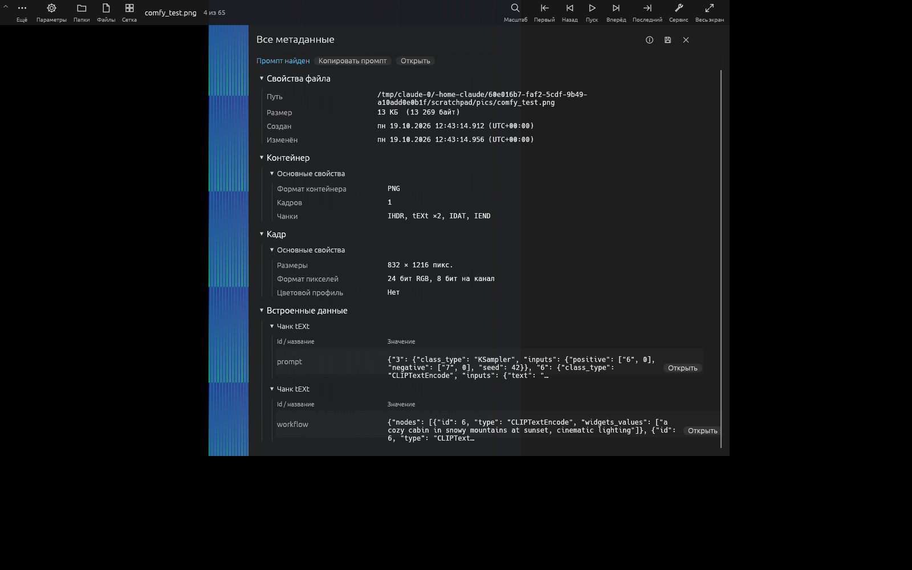
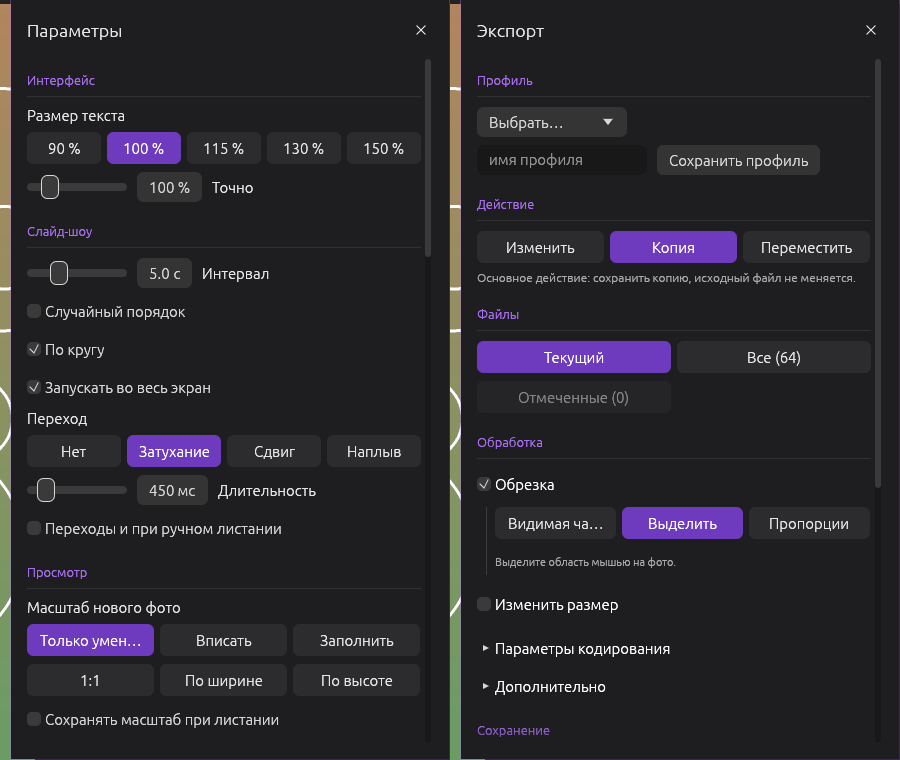
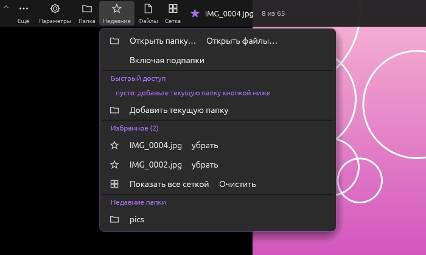
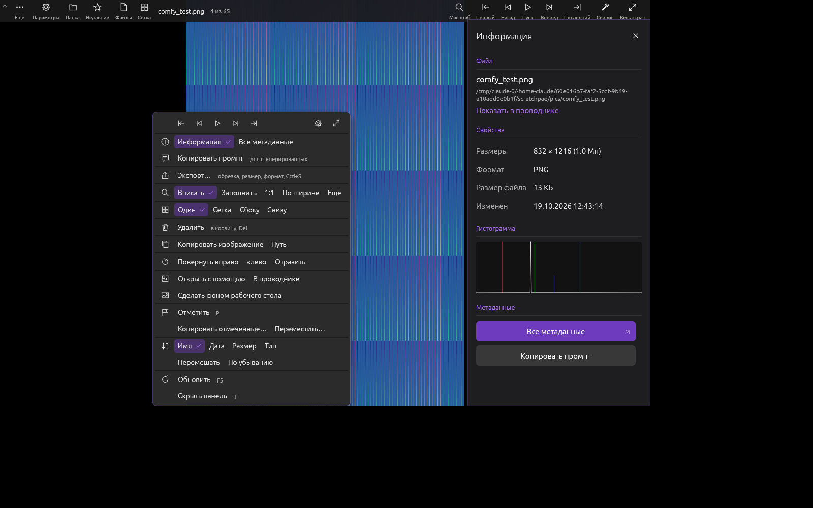

<p align="center">
  
</p>

<h1 align="center">Angle View</h1>

<p align="center">
  Быстрый минималистичный просмотрщик изображений для Windows на чистом Rust<br>
  со встроенным удалением фона нейросетью, без интернета и без C/C++ библиотек.
</p>

<p align="center">
  <a href="https://github.com/just4life/angle-view/releases/latest"><b>Скачать</b></a> ·
  <a href="#возможности">Возможности</a> ·
  <a href="#сборка-из-исходников">Сборка</a> ·
  <a href="#удаление-фона">Удаление фона</a> ·
  <a href="#клавиши">Клавиши</a> ·
  <a href="#english">English</a>
</p>

<p align="center">
  
</p>

## Возможности

**Просмотр**

- Сетка миниатюр с виртуализацией (тысячи файлов в папке), быстрые миниатюры JPEG через уменьшение в DCT, подпапки.
- Режимы: одно фото, сетка, лента миниатюр сбоку или снизу.
- Предзагрузка соседних фото, масштаб «вписать / только уменьшать / заполнить / 1:1 / по ширине / по высоте», масштаб колесом относительно курсора, поворот, отражение, учёт EXIF‑ориентации.
- Анимация GIF / WebP / APNG: пауза и покадровый просмотр.
- Сортировка по имени (с учётом чисел), дате, размеру, типу или случайно.
- Слайд‑шоу с переходами (затухание, сдвиг, наплыв), режим цифровой фоторамки, часы, дата и календарь поверх фото.
- Слежение за папкой: новые и изменённые файлы появляются сразу.

**Информация и метаданные**

- Инспектор: размеры, формат, EXIF (камера, объектив, выдержка, диафрагма, ISO, GPS), гистограмма.
- Все метаданные: свойства файла, контейнер, все поля EXIF, текстовые блоки PNG, XMP, комментарии JPEG. Поиск по полям, просмотр JSON, сохранение в файл.
- «Копировать промпт» для сгенерированных картинок: ComfyUI (prompt и workflow), AUTOMATIC1111 / Forge.

**Экспорт и обработка**

- Изменить, сделать копию или переместить: текущий файл, все или избранные.
- Обрезка (видимая область, рамка мышью, пропорции), изменение размера (пиксели, проценты, несколько размеров сразу), интерполяция до Ланцоша.
- Форматы JPEG, PNG, WebP без потерь, GIF, BMP, TIFF; качество, сжатие, дизеринг, шаблон имени, профили настроек, «В буфер обмена».
- **Удаление фона** нейросетью BiRefNet в экспорте, вместе с обрезкой и размером, на прозрачном, белом, чёрном или своём фоне. Пункт меню «Удалить фон…» (клавиша B) открывает экспорт с уже включённой галочкой.

**Файлы**

- Избранное, недавние папки и быстрый доступ.
- Выделение нескольких файлов в сетке, удаление в корзину, копирование и перемещение в папку.
- «Открыть с помощью», показать в проводнике, копировать изображение или путь, сделать фоном рабочего стола.
- Последний сеанс восстанавливается при запуске.

## Скриншоты

| | |
|---|---|
|  |  |
| Контекстное меню | Сетка и выделение нескольких файлов |
|  |  |
| Экспорт | Обрезка рамкой |
|  |  |
| Все метаданные | Параметры и экспорт |
|  |  |
| Избранное и недавние | Инспектор |

## Поддерживаемые форматы

| Открывает | Сохраняет |
|---|---|
| JPEG, PNG, APNG, GIF, WebP, BMP, TIFF, ICO, TGA, QOI, JPEG XL, SVG | JPEG, PNG, WebP (без потерь), GIF, BMP, TIFF |

HEIC, AVIF, RAW и видео видны в сетке и открываются кнопкой «в программе по умолчанию». Их поддержка через системные кодеки Windows запланирована.

## Скачать и установить

Все файлы лежат на странице [Releases](https://github.com/just4life/angle-view/releases/latest).

| Файл | Что это |
|---|---|
| `AngleView-Setup.exe` | Установщик (рекомендуется). Модель удаления фона уже внутри. |
| `AngleView.exe` | Программа одним файлом, без установки. |
| `birefnet-lite.safetensors` | Модель для удаления фона (89 МБ), нужна только к `AngleView.exe` без установщика. |
| `BgRemove-win64.zip` | Отдельные утилиты удаления фона: окно `BgRemoveDemo.exe` и консольная `bgremove.exe`. |

Требования: Windows 10 или 11, 64 бита. Видеокарта не обязательна: если DirectX 12 / Vulkan недоступны, программа сама переходит на OpenGL.

### Установщик

`AngleView-Setup.exe` ставит программу для текущего пользователя (права администратора не нужны) в `%LOCALAPPDATA%\Programs\Angle View`, добавляет ярлык в меню «Пуск» и пункт «Открыть с помощью» для всех поддерживаемых форматов. Дополнительно можно отметить:

- «Удаление фона (нейросеть, 89 МБ)», отмечено по умолчанию;
- «Ярлык на рабочем столе»;
- «Открывать все изображения в Angle View». Windows 10 и 11 не дают программам молча становиться программой по умолчанию, поэтому в конце установки откроется «Параметры → Приложения → Приложения по умолчанию», где нужно один раз нажать «Установить по умолчанию».

Удаление: «Параметры → Приложения» или `Uninstall.exe` в папке программы.

### Без установки

```
AngleView.exe D:\Фото              открыть папку сеткой
AngleView.exe D:\Фото\IMG_001.jpg  открыть фото (вся папка доступна для листания)
AngleView.exe D:\Фото --frame      сразу режим фоторамки
```

Для удаления фона положите `birefnet-lite.safetensors` рядом с `AngleView.exe` (или в подпапку `models`). Если файла нет, программа предложит указать его. Настройки хранятся в `%APPDATA%\AngleView`, туда тоже можно положить модель.

> Windows SmartScreen может предупредить о файле из интернета: сборки не подписаны сертификатом. Нажмите «Подробнее → Выполнить в любом случае» или соберите программу сами.

## Удаление фона

Удаление фона работает полностью локально, на процессоре, около 3–10 секунд на фото. Код лежит в отдельном крейте [`bg-removal/`](bg-removal), который можно использовать и без просмотрщика.

- **Модель:** [BiRefNet](https://github.com/ZhengPeng7/BiRefNet) (Peng Zheng и соавторы), вариант «lite» на Swin‑T, веса `BiRefNet-general-bb_swin_v1_tiny-epoch_232`. **Лицензия модели и весов: MIT.**
- **Откуда файл:** ONNX‑экспорт из проекта [rembg](https://github.com/danielgatis/rembg/releases/tag/v0.0.0) переведён скриптом [`bg-removal/tools/convert_birefnet.py`](bg-removal/tools/convert_birefnet.py) в `birefnet-lite.safetensors` (веса в f16, BatchNorm свёрнут в свёртки). Результат сверен с эталонной моделью: расхождение маски не больше 0.00003.
- **Как получить:** готовый файл лежит в [Releases](https://github.com/just4life/angle-view/releases/latest) и скачивается скриптом `scripts/fetch-model.ps1` (см. ниже). В git его нет из‑за размера.
- **Движок:** собственный CPU‑инференс на Rust (`swin.rs`, `conv.rs`, `birefnet.rs`), включая deformable‑свёртки. Никакого Python, ONNX Runtime или C++ рантайма.
- **Постобработка** (`matting.rs`): оставляет главный объект, уточняет край guided‑фильтром в полном разрешении и пересчитывает цвет полупрозрачных пикселей (волосы, мех), чтобы старый фон не просвечивал.

Ограничение: модель сама решает, что считать главным объектом, поэтому иногда вместе с человеком остаётся часть стула или надпись поверх фото.

## Сборка из исходников

### Windows

1. Установите [Rust](https://rustup.rs) (stable, 1.95 или новее) с инструментами Visual Studio C++ Build Tools, которые предлагает `rustup-init`.
2. Склонируйте репозиторий и скачайте модель:

   ```powershell
   git clone https://github.com/just4life/angle-view.git
   cd angle-view
   powershell -ExecutionPolicy Bypass -File scripts\fetch-model.ps1   # models\birefnet-lite.safetensors
   ```

3. Соберите:

   ```powershell
   cargo build --release                 # target\release\AngleView.exe
   cargo run --release -- D:\Фото        # запустить сразу
   ```

   Для запуска собранного exe с удалением фона скопируйте `models\birefnet-lite.safetensors` рядом с ним (отладочная сборка находит модель в `models\` сама).

4. Установщик (нужен [NSIS 3](https://nsis.sourceforge.io)):

   ```powershell
   makensis /DSRC=..\target\release installer\AngleView.nsi   # installer\AngleView-Setup.exe
   ```

### Кросс‑сборка из Linux

```sh
rustup target add x86_64-pc-windows-gnu
sudo apt install mingw-w64 nsis
cargo build --release --target x86_64-pc-windows-gnu
makensis installer/AngleView.nsi
```

Модель на Linux можно скачать так: `curl -L -o models/birefnet-lite.safetensors https://github.com/just4life/angle-view/releases/latest/download/birefnet-lite.safetensors`.

### Утилиты удаления фона

```sh
cargo build --release -p bg_removal        # bgremove: консольная утилита
cargo build --release -p bgremove_demo     # BgRemoveDemo: окно с предпросмотром
```

Подробности и API крейта: [bg-removal/README.md](bg-removal/README.md).

### Структура

```
src/                 просмотрщик (egui/eframe): app.rs, ui.rs, export.rs, decode.rs, ...
bg-removal/          крейт удаления фона: BiRefNet на Rust + постобработка
  demo/              BgRemoveDemo, окно для проверки
  tools/             конвертер весов ONNX → safetensors
installer/           установщик NSIS
assets/              иконка
scripts/             загрузка модели
docs/screenshots/    скриншоты для этой страницы
```

Сборка на каждый коммит идёт в GitHub Actions на Windows ([`.github/workflows/build.yml`](.github/workflows/build.yml)).

## Клавиши

| Клавиша | Действие |
|---|---|
| ← → / PgUp PgDn / Ctrl + колесо | предыдущее / следующее |
| Home / End | первое / последнее |
| Пробел | слайд‑шоу |
| Enter / G | сетка ↔ одно фото |
| F11 / F / двойной щелчок | весь экран |
| колесо, + / − | масштаб |
| 0 / 1 / 2 / 3 | вписать / 1:1 / заполнить / по ширине |
| R / Shift+R, H | поворот, отражение |
| I / M | информация / все метаданные |
| P | в избранное |
| B | экспорт с удалением фона |
| , / . / A | кадр анимации назад / вперёд / пауза |
| Del | в корзину |
| Ctrl+C / Ctrl+Shift+C | копировать изображение / путь |
| Ctrl+O / Ctrl+Shift+O | открыть файлы / папку |
| Ctrl+S | экспорт |
| Ctrl+A, Ctrl/Shift + щелчок | выделение в сетке |
| K / N / T / S | часы / подпись / панель / параметры |
| E / F5 / Esc | в проводнике / обновить / назад |

## Планы

- Печать.
- Фильтры и эффекты (контраст, экспозиция, уровни, кривые), редактирование метаданных.
- HEIC, AVIF, JPEG XR, RAW и видео через системные кодеки Windows (WIC, Media Foundation).
- Поиск по дате и тегам, цветовые профили ICC, 360° панорамы.

## Лицензия

Код распространяется по лицензии [MIT](LICENSE). Модель BiRefNet и её веса тоже под MIT. Лицензии сторонних компонентов (крейты Rust, встроенные шрифты egui) перечислены в [THIRD_PARTY.md](THIRD_PARTY.md).

---

## English

**Angle View** is a fast, minimalist image viewer for Windows written in pure Rust (egui/eframe, no C/C++ libraries). It has a virtualized thumbnail grid, single‑image and filmstrip views, slideshow and photo‑frame mode, full EXIF/XMP/PNG‑text metadata (including ComfyUI and A1111 prompts), and an export panel with crop, resize, format conversion and presets.

It also removes image backgrounds offline on the CPU with [BiRefNet](https://github.com/ZhengPeng7/BiRefNet) (MIT), running on a custom Rust inference engine in the [`bg-removal`](bg-removal) crate.

- **Download:** installer and portable exe on the [Releases](https://github.com/just4life/angle-view/releases/latest) page. The UI is in Russian.
- **Build:** `scripts\fetch-model.ps1` then `cargo build --release` (Rust stable 1.95+); `makensis /DSRC=..\target\release installer\AngleView.nsi` for the installer.
- **Formats:** opens JPEG, PNG, APNG, GIF, WebP, BMP, TIFF, ICO, TGA, QOI, JPEG XL, SVG.
- **License:** MIT.
